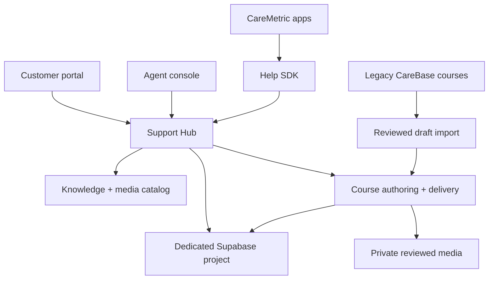

# CareMetric Support Hub

CareBase organizations now have a reviewed [Stripe billing portal workflow](docs/BILLING_PORTAL.md)
when the native billing-command capabilities are enabled. Creation requires a
reason, exact customer/configuration preview and confirmation. Uncertain responses
retain the same command; opening rechecks current authority and retrieves the
same provider session. The Hub stores redacted recovery metadata and keeps
provider credentials and billing logic in CareBase. Deployment requires the
API 4 `billing.portal.v1` gate and the reviewed native adapter.

CareBase course details include exact governed source review and native version
controls. An administrator loads a version, reviews its material and policy,
preserves that immutable source in the Hub, and previews a clone or publication.
The confirmation applies the same native command identity, including after a
connection failure. Every attempt rechecks current Hub and mapped CareBase
authority; CareBase remains the version, publication and completion writer.

The source view includes lesson bodies, assessment configuration and answer keys,
credit rules, provider evidence and package metadata. Private media paths are
excluded. Cloning preserves the published source and creates a draft that needs
its own AI review and accepted package replacements when applicable. These
controls do not yet edit draft content, record AI review or transfer media.

Deployment requires the native governed-authoring migration and adapter plus
`CAREMETRIC_LEARNING_AUTHORING_ENABLED=true` in CareBase, alongside its existing
administrator/command configuration. The Hub intent migration is
`20260911181309_learning_authoring_intents.sql`. Its private records pin source
evidence and native outcomes; they introduce no second course-content writer.
`20260911183517_governed_source_credential_keys.sql` also tightens recognized
credential fields in source JSON while preserving existing validator permissions.

CareMetric Support Hub is the first-party support, knowledge, media, learning, and product-contact platform for the CareMetric software portfolio. It is designed to replace duplicated help pages and disconnected ticket tables without introducing an outside help-desk vendor.

## Central learning release

The September 11 release deploys Hub authoring, publication, private video
playback, quizzes, learner progress, and completion records for newly authored
shared courses, with no HeyGen runtime dependency.
SDK 0.4.0 includes catalog, course-editor, and My Learning links. See
[the central learning contract and migration steps](docs/CENTRAL_LEARNING.md).
Existing CareBase courses keep their native launch paths. Their imported Hub
drafts cannot publish until quiz behavior, credits, and completion reporting are
connected. Media, identities, and legacy learning history still require verified
transfer. The owner must complete MFA before the privileged workflows can be
verified end to end.

## Current implementation status

For the September 10 portfolio audit and the proposed path to one-login
administration, shared course authoring, and consolidated SaaS billing, see
[the platform architecture audit](docs/PLATFORM_ARCHITECTURE_AUDIT.md).
The deployed Hub includes `/admin`, a searchable inventory of 97 app functions,
a read-only CareBase adapter client, and the central learning pilot. The CareBase
server adapter is deployed and its health and anonymous-denial probes passed;
the authenticated connection still requires owner-session verification. See
[the administrator connection](docs/CENTRAL_ADMIN_PILOT.md) and
[central learning](docs/CENTRAL_LEARNING.md) for their exact scope and deployment
order. Billing mutations, customer SSO, remaining app adapters, and CareBase
course cutover are still pending.

Version `0.1.0` now runs as the first production vertical slice:

- A unified customer portal and CareMetric agent console.
- Multi-product case intake, queue filtering, assignment, status and priority updates, customer replies, and staff-only notes.
- A canonical knowledge catalog with one-to-many product placements.
- A public learning library at `/learn` displaying 80 existing CareBase courses;
  search covers course titles, summaries, and categories. Existing course
  playback, quizzes, and completion continue through controlled CareBase launches.
- Native authoring and delivery for new Hub courses, including reviewed private
  media, server-graded quizzes, revision-pinned progress, and completion records.
- An MFA-protected `/admin` workspace with the app-function inventory and a
  CareBase connection for aggregate counts, shared course metadata, and lesson
  titles. Live authenticated adapter operations remain unverified.
- A governed import of 70 published CareBase help articles; no learner, employee, resident, organization, assignment, progress, or ticket records were copied.
- An owner-approved product/contact registry that publishes only approved contact values; mailbox delivery readiness is tracked separately.
- A framework-neutral `@caremetric/help-sdk` that opens Help or the shared Learning Library while passing only an allowlisted product and safe, static context.
- A dedicated `hub`/`private` Supabase schema design, RLS policies, narrow grants, atomic case RPCs, physically separate internal notes, and metadata-only audit records.
- A live TOTP enrollment/challenge flow with database-enforced AAL2 for every staff principal and for customers who opt into TOTP; the AAL1 bootstrap reveals only the minimum identity and role needed to complete enrollment.
- Fail-closed, per-tenant/product case-intake settings plus UUID request keys that make case creation and replies safely retryable without putting support text in the idempotency ledger. Runtime checks immediately reject deleted, banned, or anonymous principals and keep dual-role staff/customer authority paths separate.
- A credential-free DocStudio publication preview plus an SMS-authorized [publication import executor](docs/PUBLICATION_IMPORTS.md): exact streamed asset checks, immutable catalog revisions, explicit placement confirmations, private media, and bounded staging cleanup.
- Pull-request CI for both the application and a clean local Supabase migration/pgTAP stack.
- A polished implementation preview that works without credentials. Demo mode is never a production data store.

The private GitHub repository, isolated `CareMetric Support Hub` Supabase project (`xgauehtwksmnoqhgqegm`, `us-east-2`), and Railway deployment are provisioned. The live portal is `https://support-hub-web-production.up.railway.app`; direct `/help` and `/learn` links use production routing rather than localhost. Railway also has `help.caremetric.ai` attached; it will remain unavailable until the owner creates the required Name.com CNAME recorded in [docs/PRODUCTION_ROLLOUT.md](docs/PRODUCTION_ROLLOUT.md). The September 11 Hub deployment is `c529172`; production has 28 migrations through `20260911142604_platform_admin_session_authorization.sql`, backend contract `2`, and version `1` of the `platform-admin` Edge Function. The Data API remains restricted to `hub`. Existing application databases remain independent; the deployed CareBase catalog import contains published platform metadata.

Owner-verified central routing is `(877) 521-2890` and `support@caremetric.ai`. `kdeyarmin@comcast.net` is the active platform administrator. The owner has confirmed that the applicable BAAs are signed; the remaining High Compliance controls still require operational verification before PHI-capable intake is enabled.

## Ownership boundary

CareMetric owns the application, schema, workflows, case history, content revisions, media catalog, integration contract, exports, and backups.

Infrastructure is replaceable:

- Supabase supplies hosted Postgres, Auth, and private Storage.
- The Hub accepts reviewed videos with captions and transcripts; no video vendor is required for course delivery.
- The Hub owns authoring and delivery for new shared courses. CareBase retains
  its existing course runtime and learning records. A new course published in
  the Hub opens at `/learn/courses/<uuid>`; imported CareBase drafts remain
  blocked from publication and retain their validated native launch.
- Email and telephone providers deliver messages/calls but do not own case history.

## Architecture



The first deployment is a modular monolith. Services can be extracted only when scale, risk, or operational ownership justifies the additional failure modes.

## Run locally

Requirements: Node.js 22 or newer.

```bash
npm install
cp .env.example .env.local
npm run dev
```

`VITE_DEMO_MODE=true` starts the in-memory implementation preview. Use the Staff/Customer switch to verify both experiences. The preview rejects a case marked as containing patient or clinical information.

`VITE_DEMO_MODE` must always be set explicitly. When it is `false`, both the
production build and browser startup fail closed unless both browser-safe
Supabase values are present; a missing production variable can never silently
expose the in-memory preview. Production builds also reject demo mode itself.
CI sets the non-browser `SUPPORT_HUB_ALLOW_DEMO_BUILD=true` escape hatch only
for its credential-free preview build; never set that variable in Railway.

Run the complete application check:

```bash
SUPPORT_HUB_ALLOW_DEMO_BUILD=true VITE_DEMO_MODE=true npm run check
```

That escape hatch is for this credential-free local verification only. A
connected check can instead use `VITE_DEMO_MODE=false` with both Supabase
browser variables present.

Connected builds also call the public, data-free `hub.get_backend_contract()`
RPC and require API version `4` plus every feature in
`src/lib/backendContract.ts`. The Node server uses the same assertion at startup.
Apply the reviewed migration chain through
`20260911190819_combined_authoring_publication_support_contract.sql` before deploying
this release. The [combined release contract](docs/BACKEND_RELEASE_CONTRACT.md)
lists the guarded SQL dependencies and the separate hosted verification steps.
Missing/incompatible contracts or connection failures stop deployment. Use a
modern `sb_publishable_` key; the build probe rejects secret and legacy keys.
Preview builds keep their explicitly enabled, credential-free CI path.

## Connect the production backend

Do not connect this application to `CM Train`, PennFit, CMbackup, or any other existing production database. Create one dedicated Support Hub project in the selected Supabase organization.

1. Confirm the signed BAAs and verify the required Supabase HIPAA add-on, MFA, PITR, SSL enforcement, and network restrictions before enabling PHI-capable support.
2. Expose only the `hub` schema through the Data API. Never expose `private`.
3. Apply the reviewed files in `supabase/migrations`; `supabase/schema.sql` is the consolidated reference schema.
4. Run database/security advisors and the pgTAP tests.
5. Keep every production change represented by a reviewed, idempotent migration.
6. Configure `VITE_SUPABASE_URL` and the publishable key. Never put a secret or service-role key in a browser variable.
7. Enroll every staff account in TOTP (with a second authenticator for recovery), then provision product entitlements, tenant memberships, and explicit staff permissions.
8. Explicitly activate case intake for each approved tenant/product only after a non-banned support writer with `case.write` or `platform.admin` has verified TOTP. A missing setting remains disabled.
9. Verify the published central routing remains `(877) 521-2890` and `support@caremetric.ai`.
10. Set `VITE_DEMO_MODE=false`, build, and deploy.

Supabase changed new-project Data API exposure defaults in 2026. The schema therefore includes explicit grants, but the project must also explicitly expose `hub` in its API settings.

## PHI gate

The initial release is deliberately non-PHI:

- The intake requires a no-PHI acknowledgment and blocks submission when the requester says PHI is present.
- There are no customer attachment uploads.
- No ticket text is sent to HeyGen, analytics, AI retrieval, logs, or search indexing.
- Inbound free text is still conservatively classified `possible_phi` in the database.

Production case intake is now also gated in the database and defaults off. Do not create an activation row until the exact project is approved for the intended data class, tenant/product membership is provisioned, a TOTP-ready staff route exists, and the controls in [SECURITY.md](SECURITY.md) are operational.

## Repository structure

```text
src/                         portal and agent console
src/data/                    demo and Supabase repository adapters
src/imports/                 credential-free publication validation and preview planning
src/security/                executable security-contract tests
packages/help-sdk/           cross-product contextual help launcher
supabase/schema.sql          migration-ready schema source
supabase/tests/              pgTAP schema/security checks
docs/                        API, integration, and rollout guidance
```

## Source applications

- PennTrain is the canonical CareBase source for help, courses, learning
  execution, and existing HeyGen render metadata.
- CareMetric EMR and CareMetric Breathe have live, feature-flagged central Help
  launchers with application-owned fallbacks.
- PennSync is the canonical Base44 integration; legacy PennSync repositories are
  not parallel production sources.
- CareMetric Go has a merged cross-platform support screen; its native release
  remains gated by a verified EAS project and release workflow.
- CareMetric Intel is registered as a pilot with the shared course catalog;
  its privacy-safe launcher and deterministic guide inventory are merged, while
  authenticated production equivalence remains unverified. Current source uses
  an Express `/api` backend; reconcile the historical Base44 deployment record
  before connecting identity or delegated administration.
- DocStudio remains a content-production source, not an independently verified
  production application or the system of record for published media.

The first CareBase snapshot now includes 80 published courses and 70 published help articles. The DocStudio preview remains pure; the separate publication executor applies reviewed changes through current Hub permissions and private immutable asset storage. Deployment requires the reviewed migration and protected Edge transport described in [Publication imports](docs/PUBLICATION_IMPORTS.md). Legacy source IDs are provenance only; stable Support Hub `content_key` values are canonical.

See [docs/PRODUCTION_ROLLOUT.md](docs/PRODUCTION_ROLLOUT.md) for the verified
application-by-application deployment record, excluded duplicate/prototype
repositories, and the exact owner-controlled prerequisites that remain.

See [docs/VIDEO_GOVERNANCE.md](docs/VIDEO_GOVERNANCE.md) for the verified
HeyGen/Storage inventory and the caption, checksum, and entitlement gates for
reviewed media uploads and source-course transfer.


### Governed CareBase lesson media

The lesson media controls use the native `learning.media.v1` capability. Uploads are streamed to the fixed CareBase media endpoint with exact size and SHA-256 binding (PDF up to 25 MiB; MP4/WebM up to 100 MiB). A separate confirmation attaches a verified immutable asset to the current draft. Each step rechecks the original SMS authority and the preserved source revision. Stored locations and playback tokens never enter the Hub source snapshot.

Saved native operation IDs support receipt observation across sessions; a new session cannot finish an older session's pending upload. Committed receipts do not advance the Hub source head: reload and explicitly preserve the resulting material before editing again. PDF and video previews use the authenticated same-origin byte route with bounded single ranges. Native learner access remains governed by the native assignment/published-course resolver.

The additive `learning.media.v1` backend feature declares support for optional immutable source references. Native writes additionally require the separately deployed `CAREMETRIC_ADMIN_MEDIA_ENABLED` flag (default false), the native administrator/command flags, and current native authorization. This repository change alone does not enable a native deployment. Integrity/format verification is separate from human course-content review.
