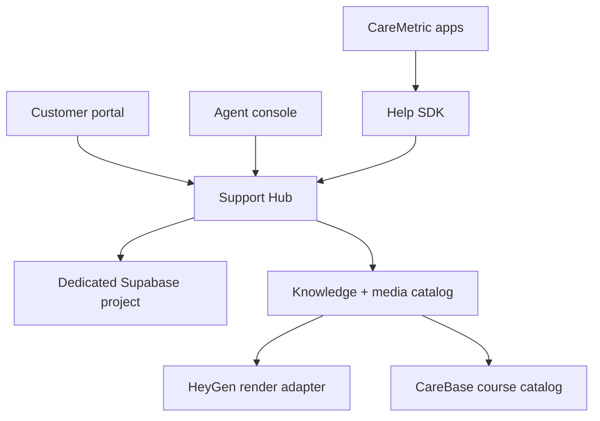

# CareMetric Support Hub

CareMetric Support Hub is the first-party support, knowledge, media, course-catalog, and product-contact platform for the CareMetric software portfolio. It is designed to replace duplicated help pages and disconnected ticket tables without introducing an outside help-desk vendor.

## Current implementation status

Version `0.1.0` now runs as the first production vertical slice:

- A unified customer portal and CareMetric agent console.
- Multi-product case intake, queue filtering, assignment, status and priority updates, customer replies, and staff-only notes.
- A canonical knowledge catalog with one-to-many product placements.
- Shared CareBase course metadata and course-level HeyGen video counts. The
  current Hub is launch-only; it does not expose or proxy private video files.
- A public, searchable learning library at `/learn` with 80 governed CareBase courses across 22 categories and 65 cataloged video lessons.
- All 65 current lesson titles are searchable and browsable in the Hub; playback, quizzes, and completion continue through each course's controlled CareBase launch.
- A governed import of 70 published CareBase help articles; no learner, employee, resident, organization, assignment, progress, or ticket records were copied.
- An owner-approved product/contact registry that publishes only approved contact values; mailbox delivery readiness is tracked separately.
- A framework-neutral `@caremetric/help-sdk` that opens Help or the shared Learning Library while passing only an allowlisted product and safe, static context.
- A dedicated `hub`/`private` Supabase schema design, RLS policies, narrow grants, atomic case RPCs, physically separate internal notes, and metadata-only audit records.
- A live TOTP enrollment/challenge flow with database-enforced AAL2 for every staff principal and for customers who opt into TOTP; the AAL1 bootstrap reveals only the minimum identity and role needed to complete enrollment.
- Fail-closed, per-tenant/product case-intake settings plus UUID request keys that make case creation and replies safely retryable without putting support text in the idempotency ledger. Runtime checks immediately reject deleted, banned, or anonymous principals and keep dual-role staff/customer authority paths separate.
- A credential-free DocStudio publication preview that validates the closed six-product manifest, verifies SHA-256 assets, plans immutable revisions, and performs no network, database, storage, or deletion operation.
- Pull-request CI for both the application and a clean local Supabase migration/pgTAP stack.
- A polished implementation preview that works without credentials. Demo mode is never a production data store.

The private GitHub repository, isolated `CareMetric Support Hub` Supabase project (`xgauehtwksmnoqhgqegm`, `us-east-2`), and Railway deployment are provisioned. The live portal is `https://support-hub-web-production.up.railway.app`; direct `/help` and `/learn` links use production routing rather than localhost. Railway also has `help.caremetric.ai` attached; it will remain unavailable until the owner creates the required Name.com CNAME recorded in [docs/PRODUCTION_ROLLOUT.md](docs/PRODUCTION_ROLLOUT.md). The live database has the reviewed migrations in `supabase/migrations`, RLS enabled on every application table, and a Data API restricted to `hub`. Existing application databases remain independent; the CareBase catalog import reads only published platform metadata.

Owner-verified central routing is `(877) 521-2890` and `support@caremetric.ai`. `kdeyarmin@comcast.net` is the active platform administrator. The owner has confirmed that the applicable BAAs are signed; the remaining High Compliance controls still require operational verification before PHI-capable intake is enabled.

## Ownership boundary

CareMetric owns the application, schema, workflows, case history, content revisions, media catalog, integration contract, exports, and backups.

Infrastructure is replaceable:

- Supabase supplies hosted Postgres, Auth, and private Storage.
- HeyGen renders approved videos but is not the source of truth and never receives PHI.
- CareBase executes courses, tests, assignments, and certificates; the Hub owns the cross-product searchable course catalog and permits launches only to the canonical `https://cmcarebase.com/app/courses` routes.
- Email and telephone providers deliver messages/calls but do not own case history.

## Architecture



The first deployment is a modular monolith. Services can be extracted only when scale, risk, or operational ownership justifies the additional failure modes.

## Run locally

Requirements: Node.js 22 or newer.

```bash
npm install
cp .env.example .env.local
npm run dev
```

`VITE_DEMO_MODE=true` starts the in-memory implementation preview. Use the Staff/Customer switch to verify both experiences. The preview rejects a case marked as containing patient or clinical information.

`VITE_DEMO_MODE` must always be set explicitly. When it is `false`, both the
production build and browser startup fail closed unless both browser-safe
Supabase values are present; a missing production variable can never silently
expose the in-memory preview. Production builds also reject demo mode itself.
CI sets the non-browser `SUPPORT_HUB_ALLOW_DEMO_BUILD=true` escape hatch only
for its credential-free preview build; never set that variable in Railway.

Run the complete application check:

```bash
SUPPORT_HUB_ALLOW_DEMO_BUILD=true VITE_DEMO_MODE=true npm run check
```

That escape hatch is for this credential-free local verification only. A
connected check can instead use `VITE_DEMO_MODE=false` with both Supabase
browser variables present.

## Connect the production backend

Do not connect this application to `CM Train`, PennFit, CMbackup, or any other existing production database. Create one dedicated Support Hub project in the selected Supabase organization.

1. Confirm the signed BAAs and verify the required Supabase HIPAA add-on, MFA, PITR, SSL enforcement, and network restrictions before enabling PHI-capable support.
2. Expose only the `hub` schema through the Data API. Never expose `private`.
3. Apply the reviewed files in `supabase/migrations`; `supabase/schema.sql` is the consolidated reference schema.
4. Run database/security advisors and the pgTAP tests.
5. Keep every production change represented by a reviewed, idempotent migration.
6. Configure `VITE_SUPABASE_URL` and the publishable key. Never put a secret or service-role key in a browser variable.
7. Enroll every staff account in TOTP (with a second authenticator for recovery), then provision product entitlements, tenant memberships, and explicit staff permissions.
8. Explicitly activate case intake for each approved tenant/product only after a non-banned support writer with `case.write` or `platform.admin` has verified TOTP. A missing setting remains disabled.
9. Verify the published central routing remains `(877) 521-2890` and `support@caremetric.ai`.
10. Set `VITE_DEMO_MODE=false`, build, and deploy.

Supabase changed new-project Data API exposure defaults in 2026. The schema therefore includes explicit grants, but the project must also explicitly expose `hub` in its API settings.

## PHI gate

The initial release is deliberately non-PHI:

- The intake requires a no-PHI acknowledgment and blocks submission when the requester says PHI is present.
- There are no customer attachment uploads.
- No ticket text is sent to HeyGen, analytics, AI retrieval, logs, or search indexing.
- Inbound free text is still conservatively classified `possible_phi` in the database.

Production case intake is now also gated in the database and defaults off. Do not create an activation row until the exact project is approved for the intended data class, tenant/product membership is provisioned, a TOTP-ready staff route exists, and the controls in [SECURITY.md](SECURITY.md) are operational.

## Repository structure

```text
src/                         portal and agent console
src/data/                    demo and Supabase repository adapters
src/imports/                 credential-free publication validation and preview planning
src/security/                executable security-contract tests
packages/help-sdk/           cross-product contextual help launcher
supabase/schema.sql          migration-ready schema source
supabase/tests/              pgTAP schema/security checks
docs/                        API, integration, and rollout guidance
```

## Source applications

- PennTrain is the canonical CareBase source for help, courses, learning
  execution, and existing HeyGen render metadata.
- CareMetric EMR and CareMetric Breathe have live, feature-flagged central Help
  launchers with application-owned fallbacks.
- PennSync is the canonical Base44 integration; legacy PennSync repositories are
  not parallel production sources.
- CareMetric Go has a merged cross-platform support screen; its native release
  remains gated by a verified EAS project and release workflow.
- CareMetric Intel is registered as a pilot with the shared course catalog;
  its privacy-safe launcher and deterministic guide inventory are merged, while
  Base44 publication remains blocked by the hosted sandbox/bridge.
- DocStudio remains a content-production source, not an independently verified
  production application or the system of record for published media.

The first CareBase snapshot now includes 80 published courses and 70 published help articles. The DocStudio boundary can now validate and hash a publication bundle and produce a deterministic, approval-required preview, but it cannot commit, upload, fetch, or delete anything. Legacy source IDs are provenance only; stable Support Hub `content_key` values are canonical.

See [docs/PRODUCTION_ROLLOUT.md](docs/PRODUCTION_ROLLOUT.md) for the verified
application-by-application deployment record, excluded duplicate/prototype
repositories, and the exact owner-controlled prerequisites that remain.

See [docs/VIDEO_GOVERNANCE.md](docs/VIDEO_GOVERNANCE.md) for the verified
HeyGen/Storage inventory and the caption, checksum, and entitlement gates for
future inline playback.
