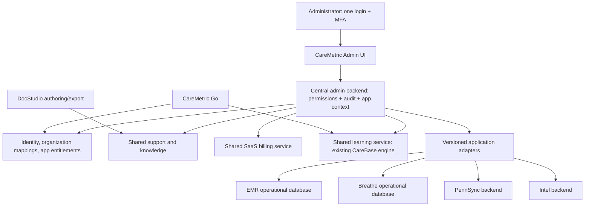

# CareMetric central administration: architecture and integration audit

Reviewed September 10, 2026. Scope: the Support Hub and eight connected/canonical repositories, their integration boundaries, selected production infrastructure, and shared publication contracts. This is an integration and readiness audit, not an exhaustive security audit of every clinical workflow.

## Decision

Evolve the existing Hub into **CareMetric Admin**, with one administrator sign-in and one interface for organizations, users, courses, subscriptions, support, integrations, and operational health. Add a central backend that checks permissions and calls narrowly scoped application adapters. Retain the existing app databases and their domain rules. Use CareBase as the shared learning service and the Hub as the common support service.

The existing Hub is a useful starting point, but it is **not currently a complete central super admin application**. Single sign-on, remote app administration, central billing, course editing in the Hub, and automatic course publication synchronization are not implemented. They cannot be certified as working through existing Help links.

| Approach | Assessment |
| --- | --- |
| Directory of links or embedded app screens | Useful transition aid; separate sessions and duplicate code remain. Several apps block embedding. Does not meet the final requirement. |
| Central admin interface, shared domain services, small app adapters | **Recommended.** Reuses the existing learning/billing logic, preserves tenant isolation, and permits gradual migration with rollback. |
| Move every app and database into one new system immediately | Largest regression and migration risk. Different auth systems and deployment stacks make this unnecessary for achieving one login. |

The diagram is the target design. Most arrows from the central admin backend still need to be built.

## What the audit found

| Priority | Finding and evidence | Disposition |
| --- | --- | --- |
| P1 | **Production frontend/database mismatch broke the actor bootstrap.** Railway deployed Hub `def580f`; its client requires `memberships`. Production stopped at migration `20260907222641`, and the actor RPC did not return that field. [Client evidence](https://github.com/kdeyarmin/caremetric-support-hub/blob/def580fed48550696ec676f6d0655d7e8054d73c/src/data/supabaseRepository.ts#L80). | Applied the exact two previously merged migrations; verified both new definitions and restored their original migration versions after checking the applied SQL matched. Production now includes the membership and safe-assignee fixes. |
| P1 | **No single sign-on or delegated administration.** Production has zero federation issuers and zero mapped principals. The SDK builds context links and has no session-exchange transport. The Hub repository exposes support/content operations only. [SDK](https://github.com/kdeyarmin/caremetric-support-hub/blob/def580fed48550696ec676f6d0655d7e8054d73c/packages/help-sdk/src/index.ts), [domain contract](https://github.com/kdeyarmin/caremetric-support-hub/blob/def580fed48550696ec676f6d0655d7e8054d73c/src/domain.ts). | Build central identity, mappings, and authorized server adapters before claiming one-login administration. |
| P1 | **The central support queue cannot yet receive customer cases.** Production has zero tenants, cases, and intake settings; zero verified TOTP factors exist. Intake correctly remains disabled. Existing local ticket systems are still separate. | Owner completes MFA; provision verified tenant/product memberships and support routing. Migrate existing cases with provenance and visibility preservation before retiring local writers. |
| P1 | **Course creation and runtime are outside the Hub.** The Hub's content creation button was disabled, the repository has no course-write API, and launches go to `/app/courses`. CareBase already implements manual courses, AI generation, quizzes, and versioned learning. [Hub library](https://github.com/kdeyarmin/caremetric-support-hub/blob/def580fed48550696ec676f6d0655d7e8054d73c/src/App.tsx#L1095), [CareBase admin routes](https://github.com/kdeyarmin/PennTrain/blob/9f921c6bd2394eea9e40bd18d01f09602a33ee7c/artifacts/caremetric-carebase/src/App.tsx#L613). | Added a reviewed source change linking platform admins to the real CareBase authoring console and corrected misleading copy. Moving that editor behind the Hub session still requires the learning API and identity bridge. |
| P1 | **Billing is duplicated and has no Hub aggregation or write API.** CareBase and Breathe each implement billing and entitlement logic; EMR has its own subscription management. A Hub case category called `billing` is not a billing module. [Breathe platform console](https://github.com/kdeyarmin/PennFit/blob/c966b887c84095dec3c47b974da27e11d4ce8887/artifacts/cpap-fitter/src/pages/platform/console.tsx), [EMR super admin](https://github.com/kdeyarmin/CMbackup/blob/07f1393b6808b77317f0a29fa4595c6722b96520/src/components/SuperAdminDashboard.tsx). | Consolidate subscription ownership and entitlement decisions deliberately; preserve provider account/customer/subscription identifiers and avoid creating replacement charges. |
| P2 | **Catalog sharing is a snapshot, not an automatic publishing pipeline.** The 80 public CareBase courses are imported by SQL migrations. No live publish/change/retirement transport exists. DocStudio import is a deterministic preview only. | Add an authenticated outbox/inbox pipeline, revision ordering, retirement events, retries, and reconciliation. A published catalog entry must never imply an entitlement to private media. |
| P2 | **DocStudio and Hub validators disagreed.** A real exporter accepted `release-7` and `shared..team-guide`; the actual Hub importer rejected both. | Fixed DocStudio source identifier validation and added regression coverage. A valid hashed article successfully crossed the real producer/consumer boundary for all six products. |
| P2 | **Integration releases remain incomplete.** CareBase's live `support.central_hub` flag is `off`; Go still has `YOUR_EAS_PROJECT_ID`; PennSync authenticated click-through is unverified. Intel's current source uses an Express `/api` client while the old rollout describes a Base44-hosted deployment. | Keep source, deployed revision, identity backend, and verified capabilities separate in the registry. Resolve Intel runtime/deployment ownership before connecting admin or SSO. Native Go release requires its own verified build/release setup. |
| P2 | **Support DNS and mail are not ready.** `help.caremetric.ai` and `_dmarc.caremetric.ai` return NXDOMAIN. No MX or SPF record was returned for `caremetric.ai`. The registered support address is not evidence of message delivery. | Continue using the working Railway address. Configure the already documented CNAME and the chosen mail provider's exact records, then test inbound/outbound delivery. |
| P2 | **The same shared-code contract already has version drift.** The Hub SDK is `0.3.0`; PennSync vendors `0.1.0`; the other clients implement their own adapters. PennSync's current call omits `routeAllowlist`, which SDK 0.3 requires to retain route context. | Publish immutable shared packages, migrate call sites alongside version changes, and run producer/consumer tests. Do not blindly replace the tarball. |
| P2 | **Deployment health checks did not prove API compatibility.** Railway checked `/`, which can return static HTML while the database contract is incompatible. | Added a public, data-free API contract and a connected-build check. Missing/incompatible contracts and network failures stop the build. The new backend contract is deployed and verified; frontend build enforcement is in the prepared Hub change. |
| P3 | **Windows checkout line endings broke two existing verification tests.** Their immutable SQL byte count/hash and newline regex passed in Linux CI but failed locally with CRLF. | Added `.gitattributes` with LF for text. Existing migration SQL remains unchanged in Git. All local Hub checks now pass. |

Additional live observation: all 25 application tables have RLS enabled and both exposed views are security-invoker. The security advisor still reports leaked-password protection disabled; its ten policy-free private-table notices correspond to the intentionally inaccessible private schema. [Password-protection guidance](https://supabase.com/docs/guides/auth/password-security#password-strength-and-leaked-password-protection). These checks do not establish organization-wide compliance or exhaustive security assurance.

## Application ownership and reuse

| Application | Canonical source reviewed | Existing functions to surface centrally | Integration assessment |
| --- | --- | --- | --- |
| Admin/Support Hub | `caremetric-support-hub@def580f` | Cases, public knowledge/catalog, product/contact registry, MFA | Shared foundation; no remote admin or billing backend |
| CareBase | `PennTrain@9f921c6` | Organizations, users, packages, course editor, AI course wizard, quizzes, training plans, jobs, release flags, support, security | Canonical learning engine; live central Help flag remains off |
| Breathe | `PennFit@c966b88` | Tenant lifecycle, operators, billing, costs, outreach, support, global integrations, connection tests, system configuration | Custom server/session system; requires a server adapter |
| EMR | `CMbackup@07f1393` | Practices/users, contacts, subscriptions, Stripe tools, support, analytics, communications, security, videos, audit | Separate Supabase app; preserve clinical billing domain |
| PennSync | `CareMetric-Pennsync@cb64251` | Admin operations/users, integration settings, training generation, learning reports, agency controls | Hosted Base44 backend; its protected role checks cannot be replaced by a Hub URL parameter |
| Go | `CM-Go@a30a49c` | Provider/patient support and learning entry points; central account entitlements | Consumer app, not a separately verified super admin backend; native release blocked |
| Intel | `intel@c57776d` | Admin settings, integrations, import/crawler jobs, provider intelligence operations | Source uses Express/Postgres and JWT; deployed authenticated API equivalence not verified |
| DocStudio | `DocStudio@d02d0a2` | Documentation authoring, capture/render jobs, governed export | No independent production frontend verified; publishing executor absent |
| PennSite | `PennSite@f7aa91f` | Public software Help entry point | Marketing/service site; not an admin or clinical product |

Exclude the historical `caremetric-carebase`, `pennsync`, and `pennsync2` duplicates. Keep unrelated repositories and unverified prototypes outside this migration. The companion CSV inventories 97 selected source routes and administration surfaces across nine repositories, with immutable source links. It is not a claim that every backend handler was tested.

## How to build the target

### 1. One session and one permission model

Use the Hub's dedicated identity domain as the administrator entry point. Supabase now supports OAuth 2.1/OIDC with authorization code + PKCE, so it is a viable identity provider to evaluate against each app. That capability is documented; it is not configured in this portfolio. [Official OAuth server documentation](https://supabase.com/docs/guides/auth/oauth-server).

Maintain canonical `principal_id`, `organization_id`, and `application_id` records plus explicitly verified mappings to existing app identities. Email equality must not silently merge accounts or grant super admin rights. Check current role, account state, session validity, organization/app scope, and MFA at each privileged operation. Define fine-grained permissions such as course publishing, billing changes, user administration, and support access. The Hub frontend never receives another app's service-role credentials.

For existing custom-auth apps, the Hub backend calls a narrow app-owned adapter with a short-lived signed, audience-bound request and an explicit actor/tenant mapping. The adapter rechecks current permission and records the original actor. Use server-held sessions, exact redirect allowlists, state/nonce checks, revocation, and logout tests. Keep a separately controlled emergency recovery route. Base44 capability must be verified before promising native SSO there. [OAuth token and RLS guidance](https://supabase.com/docs/guides/auth/oauth-server/token-security).

### 2. One learning service

Reuse CareBase's existing course engine. Move reusable authoring components and contracts into versioned packages, and present them inside the Hub against a first-party learning API. Separate the editor's routing/auth integration from its business rules. Keep one canonical course ID and immutable revisions; attach product placements and organization entitlements to it.

Provide manual/AI authoring, lesson assets, quizzes, review/approval, publishing, retirement, categories, assignments, reporting, and certificate configuration from the Hub. Keep assignments, progress, quiz results, and certificates tenant-scoped in the learning service. Existing completions stay bound to their completed course version. A course update must not rewrite evidence of earlier completion.

Publish metadata changes using a transactional outbox. The Hub inbox deduplicates events, checks revision sequence, applies placements, and exposes the last successful sync time and failures. Reconcile against the source periodically. Videos require private storage, verified checksums/captions, and an entitlement-aware broker; an anonymous catalog must never expose protected playback URLs.

### 3. One SaaS billing and entitlement service

First inventory each app's billing provider account, customer ID, subscription ID, price catalog, paid-seat rules, trials, credits, and overrides. Preserve those identities. Store money with currency and integer minor units; do not combine unlike currencies into a single revenue total.

Unify subscription/invoice views, then migrate mutations one product/cohort at a time. One service should decide app entitlements from current subscription state, grace periods, approved overrides, and revocations. Keep each existing subscription owned by exactly one writer during migration.

Verify webhook signatures over the raw payload, durably record receipt, deduplicate by provider/account/event, and handle retries and out-of-order delivery. Reconcile with provider state and expose failed events for controlled replay. Use restricted server-side keys and test-mode billing scenarios. [Stripe webhook documentation](https://docs.stripe.com/webhooks). Evaluate Stripe Tax and actual registrations before changing tax collection; preserve existing tax behavior until that review is complete. [Recurring-payment tax setup](https://docs.stripe.com/billing/taxes/collect-taxes).

Here, central billing means **CareMetric software subscriptions**. Insurance claims, patient balances, clearinghouse submission, and clinical billing remain domain-specific services. Their admin controls can be surfaced centrally later through scoped APIs without copying patient records into the support database.

### 4. One support system

Adopt Hub cases as the source of truth, with immutable source-system/source-case mappings for imports. Preserve customer messages separately from internal notes; preserve original timestamps and attribution. Import attachments only after the storage boundary exists. Verify record counts, visibility, and history before cutting over each app's writer. Provide a rollback flag and avoid bidirectional ticket writers that create duplicates.

Connect email and phone dispositions after verifying delivery, webhook authentication, and the intended data boundary. Keep healthcare-service contacts distinct from CareMetric software support.

### 5. Shared code and operation contracts

Start with a modular backend in the Hub repository, alongside its frontend and packages. Keep independent app repositories during transition. A portfolio-wide monorepo is optional; code reuse depends on maintained package/API contracts, not repository location.

Create versioned packages for product IDs, identity claims, permission names, API request/response schemas, Help/learning launchers, and publication manifests. Remove duplicate validators only after both producer and consumer run the same contract tests. Avoid separate copies of course editors and billing logic.

Each app adapter should advertise its environment, deployed commit, API version, supported operations, and last successful probe. A timeout is `unavailable`, never zero users, zero revenue, or healthy. Use bounded requests, retry policies, idempotency keys for writes, correlation IDs, and audit events without raw sensitive payloads. Keep one app's outage from blocking the entire admin dashboard.

### 6. Proposed admin surface

The following modules and endpoints are a design specification, not shipped APIs:

| Hub module | Proposed backend responsibility |
| --- | --- |
| Overview / Apps | `GET /admin/v1/apps` — real capabilities, deployment and sync health |
| Organizations / Users | Canonical directory and verified app mappings; scoped lifecycle operations |
| Courses / Media | Shared authoring, reviews, immutable publishing, placements, learning reports |
| Billing / Entitlements | Existing subscription aggregation, previewed plan changes, invoices, access reconciliation |
| Support / Knowledge | Existing Hub case services plus import and inbound-channel adapters |
| Integrations / Jobs | Secret references, connection tests, background jobs, controlled retries |
| Security / Audit | Roles, MFA, sessions, revocation, permission changes, action history |

## Rollout and acceptance gates

| Stage | Deliverable | Evidence required to call it complete |
| --- | --- | --- |
| 0: Restore and expose readiness | Current fixes, API contract gate, source/deployment registry, administrator MFA | Connected build, migrations, public pages, and real administrator sign-in pass; no invented green health status |
| 1: Central identity + one pilot adapter | Hub session mapped to CareBase, directory and read-only app capability view | One sign-in opens authorized Hub/CareBase functions; disabled user, wrong tenant/app, expired session, and missing MFA all fail |
| 2: Shared learning authoring | Real CareBase editor in Hub, publication events, private media access | Create once in Hub, publish to two apps, verify same course/revision; revocation denies private playback; existing certificates remain unchanged |
| 3: SaaS billing | Consolidated existing subscriptions, previewed mutations, one entitlement authority | Test-mode upgrade/downgrade/cancel/grace flows work; duplicate/out-of-order webhooks do not duplicate charges or grant stale access |
| 4: Support consolidation | Verified identity mapping, case import, per-app cutover, email/phone transport | New case from every app arrives once; customer cannot read internal notes; replies and rollback work; mail delivery is proven |
| 5: Remaining administration | Breathe, EMR, PennSync, Intel adapters and Go release integration | Every inventory function is either implemented in Hub or explicitly assigned a remaining owner; central revocation and failure isolation work |
| 6: Remove duplication | Shared packages, retired local writers/editors, operational runbooks | No production caller uses retired paths; restore/rollback drill and multi-app end-to-end tests pass |

Start with CareBase because it already owns shared learning. Keep feature flags and read-only comparisons until each migrated operation passes. Do not delete old implementations merely because a new screen renders.

## Verification and limits

- Live public HTTP checks returned 200 for Hub Help/Learn, CareBase, Breathe, EMR, PennSync, Intel, and PennSite. A 200 response establishes reachability, not authenticated workflow correctness.
- The live Hub rendered 80 public courses, 22 categories, 65 lesson titles, and six products. Browser search for the diabetes course returned one result and expanded its 12 lesson titles.
- That course's exact CareBase launch URL rendered its matching course details and versions in the existing browser session. No new sign-in, learner enrollment, completion, or private playback was tested. The updated local Hub library also rendered correctly with the authoring boundary explained; its support-manager preview did not expose the platform-admin authoring link.
- Read-only CareBase metadata confirmed 80 published platform courses. The central Help feature flag remains disabled.
- Before changes, local Hub checks failed two line-ending-sensitive assertions. After fixes: 187 Hub tests, 22 SDK tests, typecheck, lint, SDK build, preview build, and connected production build passed. There is an existing bundle-size warning (~537 KB before gzip).
- The exact original Hub commit's GitHub CI passed 126 database assertions across five suites. Docker Desktop could not start its engine on this host, so a new local full database replay was unavailable. The new release-contract behavior was separately checked against the connected database using anonymous/authenticated roles without granting actor access. Fresh PR database CI is the gate for the complete updated migration chain.
- DocStudio passed 13 contract tests; Go passed three support-link tests; PennSite passed three support-link tests. A real DocStudio producer-to-Hub-consumer article preview passed after fixing the two reproduced mismatches.
- No authenticated multi-app SSO flow, charge/refund, native release, private video playback, inbound email/phone flow, or end-to-end customer case flow was certified. No clinical data migration or subscription migration was attempted.
- Production changes in this audit were limited to the Hub RPC migrations and public release metadata. Tenant intake stays disabled. The owner must complete their own MFA enrollment; no factor was fabricated or bypassed.

This audit establishes a concrete path and fixes verified integration defects. Full one-login administration remains an implementation program with the acceptance gates above.
